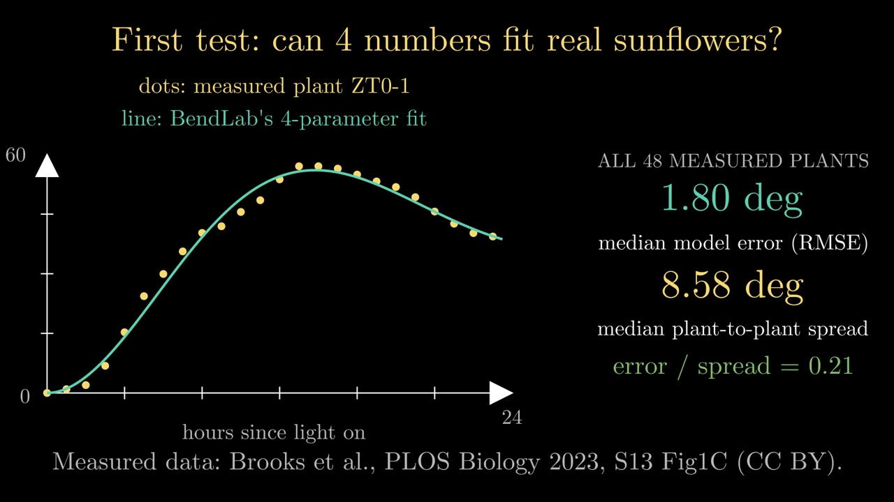
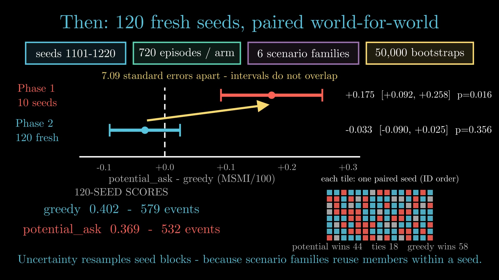

# Projects in Motion

**Research and software, explained through animation.**

Projects in Motion is a growing collection of short animated explainers by
[Anadi Tripathi](https://github.com/Yash-Tripath1). Every entry brings
together the finished film, the Python source code that generated it, and
notes connecting what appears on screen to the underlying project, data and
results.

The aim is simple: do not just state what a project found or built — show
how it behaves.

[](videos/001-bendlab/)

## Catalogue

| No. | Film | Subject | Watch | Code & notes | Project |
|---:|---|---|---|---|---|
| 001 | **BendLab** | Phototropic stem bending and parameter identifiability | [Readable cut · 2:00](videos/001-bendlab/BendLab_slow_0.5x.mp4) · [Original · 1:00](videos/001-bendlab/BendLab.mp4) | [`scene.py`](videos/001-bendlab/scene.py) · [Film notes](videos/001-bendlab/README.md) | [BendLab repository](https://github.com/Yash-Tripath1/Bendlab) · [Live site](https://yash-tripath1.github.io/Bendlab/) |
| 002 | **Sequential Matchmaking** | Sequential reciprocal matching, selection effects and replication | [Readable cut · 2:31](videos/002-sequential-matchmaking/SequentialMatchmaking_slow_0.5x.mp4) · [Original · 1:15](videos/002-sequential-matchmaking/SequentialMatchmaking.mp4) | [`scene.py`](videos/002-sequential-matchmaking/scene.py) · [Film notes](videos/002-sequential-matchmaking/README.md) | [Research repository](https://github.com/Yash-Tripath1/sequential-matching-public-simulator-lab) · [Paper](https://github.com/Yash-Tripath1/sequential-matching-public-simulator-lab/blob/main/PAPER.md) |

New films will be added in numbered order as more projects are animated.

## Latest film: Sequential Matchmaking

**When a winning policy meets twelve times the data, does the win survive?**

[](videos/002-sequential-matchmaking/)

Sequential Matchmaking follows a reported **+0.175** policy advantage from a
ten-seed screen into a paired test on **120 fresh simulator seeds**. The film
shows the daily clarify-then-match mechanism, the selection effects behind
the first result, the exact code-recovery check, and the structural findings
that do replicate when the policy ranking does not.

Highlights include:

- A daily allocation problem over **200 synthetic members**, a 12-unit
  clarification budget and reciprocal hard-constraint gates.
- A Phase 1 result of **0.525 versus 0.350**, followed by a 120-seed result
  of **0.369 versus 0.402** for the same comparison.
- One tile for each paired seed: the Phase 1 incumbent wins 44, ties 18 and
  loses 58 against the supplied greedy baseline.
- A replicated structural result: removing clarification costs **0.304
  MSMI/100**, while coverage reaches **97.8%** of its structural ceiling.
- A positive but unresolved **+0.013** candidate effect, reported with the
  minimum detectable effect rather than adopted on noise.

▶️ [Watch the 2:31 readable cut](videos/002-sequential-matchmaking/SequentialMatchmaking_slow_0.5x.mp4) ·
[Read the film notes and sources](videos/002-sequential-matchmaking/README.md)

## Featured film: BendLab

**Can a bending sunflower reveal the numbers behind its bend?**

BendLab studies whether the four parameters of a minimal model of
phototropic stem bending can be recovered from an observed stem-angle
trajectory. The film follows the question from a real sunflower trajectory
to BendLab's central caution: **a good fit is not a unique explanation.**

Highlights include:

- A four-parameter model fitted to **48 measured sunflower trajectories**.
- A median model error of **1.80°**, compared with a median plant-to-plant
  spread of **8.58°**.
- An exactly invisible parameter: when a plant never reaches its fitted
  bend-rate limit, that limit cannot be recovered from its trajectory.
- Evidence from **10,000 simulated plants** that similar behaviour can come
  from substantially different parameter combinations.
- A negative protocol result kept in the story rather than edited out.

▶️ [Watch the two-minute readable cut](videos/001-bendlab/BendLab_slow_0.5x.mp4) ·
[Read the film notes and sources](videos/001-bendlab/README.md)

## What each entry contains

```text
projects-in-motion/
├── README.md                    # catalogue and project overview
├── LICENSE
├── requirements.txt             # shared Python dependency
└── videos/
    ├── 001-bendlab/
    │   ├── BendLab_slow_0.5x.mp4   # recommended viewing cut
    │   ├── BendLab.mp4             # original render
    │   ├── scene.py                # complete generated-film source
    │   ├── poster.jpg              # representative still
    │   ├── README.md               # timeline, sources and credits
    │   └── data/                   # data used or cited by the film
    └── 002-sequential-matchmaking/
        ├── SequentialMatchmaking_slow_0.5x.mp4
        ├── SequentialMatchmaking.mp4
        ├── scene.py
        ├── poster.jpg
        ├── README.md
        └── data/
```

Only material needed to watch, understand, inspect or reproduce an entry is
kept in its folder. Temporary previews and generated working files are not
stored in the repository.

## Editorial approach

These films are visual explanations, not promotional trailers. Each entry
aims to follow the same standards:

1. **Show the mechanism** — animate the process, relationship or failure
   mode at the centre of the project.
2. **Use real material where possible** — measured data, fitted values,
   simulation output and project results rather than decorative stand-ins.
3. **Trace the numbers** — the accompanying notes identify where important
   quantities shown on screen come from.
4. **Separate evidence from illustration** — schematic drawings and
   simplified visual metaphors are labelled as such.
5. **Keep limitations visible** — negative results, approximations and
   open questions belong in the explanation.
6. **Make the work inspectable** — finished videos are published together
   with their generating code and, where licensing permits, supporting data.

## Exploring the code

Each film is defined by the `scene.py` file stored beside its rendered
video. The files are structured in named sections so individual ideas can
be read, modified and reused independently.

The shared Python dependency is pinned in
[`requirements.txt`](requirements.txt). The current entries use Python 3.13
or 3.14.

```bash
python -m pip install -r requirements.txt
```

Production details, source references and any data required for a
particular film are documented in that film's own `README.md`.

## About

Projects in Motion is created and maintained by **Anadi Tripathi**
([@Yash-Tripath1](https://github.com/Yash-Tripath1)) — developer, student
and occasional researcher working across simulation, machine learning,
software systems and interactive tools.

- Portfolio: [anadi-dev.vercel.app](https://anadi-dev.vercel.app)
- GitHub: [github.com/Yash-Tripath1](https://github.com/Yash-Tripath1)

Individual project collaborators are credited within the relevant film
folders. BendLab is led by Anadi Tripathi with Umaid as a
collaborator; Sequential Matchmaking's research and paper are by
Anadi Tripathi.

## Licence and attribution

Unless otherwise stated in an individual folder, original code and text in
this repository are released under the MIT Licence. See
[`LICENSE`](LICENSE).

Third-party datasets, media and project material retain their original
licences and are attributed in the corresponding film notes. For example,
the sunflower measurements used in BendLab come from Brooks, Atamian and
Harmer (2023), published in PLOS Biology under CC BY.
